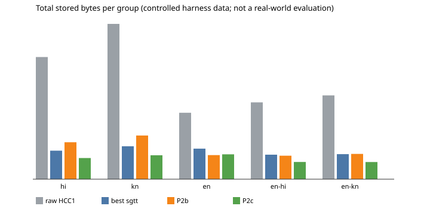

# P2c controlled-data demo (harness demonstration, not an evaluation)

*The independent evaluation, which can decide the criterion, is a separate workflow: `docs/phase2_p2c_evaluation.md`. It is not run, and its data is not approved.*

> **Controlled harness data only.** `phase1-kn-hi-v1` and `phase1-en-mixed-v1` are small synthetic/curated datasets accepted for harness validation, and not reviewed by native speakers.
> - These results **do not establish real-world compression effectiveness**.
> - They **cannot satisfy** the Phase 2 criterion: at least 5% fewer total stored bytes than the best `sgtt` baseline on approved, independent Hindi and Kannada evaluation data, with no evaluated group more than 5% worse. That criterion is unchanged and still blocked (FLORES+ isn't approved).

## Command
```bash
python3 -I benchmarks/phase2/p2c_demo.py            # report from the recorded runs below (about 2 s)
python3 -I benchmarks/phase2/p2c_demo.py --fresh    # re-run the harness twice per dataset first (about 1 min), then report
```
It prints the table below, and writes `results/phase2/p2c-demo/{summary.txt, summary.json, per_column.csv, group_totals.svg}`.

**How the numbers are produced:**
- Every byte count is the harness's own `total_stored_bytes`, the serialized HCC1 container size: header, length table and codec blob (token IDs, P2b/P2c mapping or `sgtt` bitmap, and footer).
- Nothing is re-counted.
- Shared vocabularies are static assets, reported separately and never charged per column, under the same rule for every method.

## Methods
| Method | What it is |
|---|---|
| raw | HCC1 with the value bytes stored as they are |
| best `sgtt` | per column, the smaller of upstream `sgtt` OpenAI200K Dense and Gemma3 Dense (unmodified upstream codec) |
| P2b | HCC1 codec 3 with the P2a vocabulary (`c99ff52f…`) |
| **P2c** | HCC1 codec 3, unchanged, with the **frozen** P2c vocabulary `codec/p2c/p2c_vocabulary_v1.bin`: SHA-256 `1e12dc488beddfdf0242268fd17cdd90e93d834be0a81e6780754bcbc629dc84`, 65,536 entries (u16 IDs), 655,073 B, **L = 32,768** (16,384 Hindi + 16,384 Kannada learned entries), trained only on Wikipedia `hiwiki` + `knwiki` dump 20261001 (report §11.2) |

**Not tuned on this data:** the vocabulary and L were fixed before this demo, from held-out *training* text.

## Data and columns included
- **Datasets:** `phase1-kn-hi-v1` (SHA-256 `359269f4…`, 65 samples) and `phase1-en-mixed-v1` (`6c4685c2…`, 81 samples).
- **Totals:** the 40 non-overlapping `col-<language>-<category>` columns. That is 5 language groups × 8 categories:
  - `short`, `medium`, `long`, `repeated`, `punct_numerals`;
  - `mixed` (kn-hi) or `structured` (en-mixed);
  - `edge`, `tiny`.
- **Values:** 146 in total.
- **Runs:** the harness runs all 30 + 32 columns, including the overlapping aggregate columns (434 rows per run). All of them are checked for exact round trips and audited.
- **Overlap check:** found none of these samples in the P2c training text (report §11.2).

## Results (total stored bytes; positive % = smaller than best `sgtt`)
| Group | Columns | Original | Raw | Best `sgtt` | P2b | **P2c** | P2c vs best `sgtt` | P2b vs best `sgtt` |
|---|---|---|---|---|---|---|---|---|
| hi | 8 | 10,511 | 10,619 | 2,479 | 3,209 | **1,837** | +25.9% | −29.4% |
| kn | 8 | 13,391 | 13,502 | 2,861 | 3,796 | **2,077** | +27.4% | −32.7% |
| en | 8 | 5,665 | 5,775 | 2,656 | 2,091 | **2,161** | +18.6% | +21.3% |
| en-hi | 8 | 6,584 | 6,679 | 2,129 | 2,040 | **1,494** | +29.8% | +4.2% |
| en-kn | 8 | 7,188 | 7,284 | 2,175 | 2,195 | **1,492** | +31.4% | −0.9% |
| **All 40** | 40 | 43,339 | 43,859 | 12,300 | 13,331 | **9,061** | **+26.3%** | −8.4% |



Per-column numbers are in `results/phase2/p2c-demo/per_column.csv`.

**Where the difference comes from (token counts, controlled data):**

| Column | Best `sgtt` bytes (tokens) | P2b bytes (tokens) | P2c bytes (tokens) |
|---|---|---|---|
| col-hi-long | 381 (139) | 569 (278) | 301 (137) |
| col-kn-long | 398 (209) | 633 (342) | 343 (158) |
| col-hi-repeated | 1,081 (860) | 1,898 (1,674) | 1,014 (840) |
| col-kn-repeated | 1,430 (1,247) | 2,366 (2,114) | 1,184 (990) |
| col-en-long | 569 (189) | 413 (192) | 435 (203) |

- **Indic text:** P2b's gap was token count, about twice `sgtt`'s on long Indic text. P2c's learned entries bring it to about `sgtt`'s count or fewer. Its lower fixed cost per column (no bitmap, and a 13-byte rather than 24-byte footer) then decides the totals.
- **Small columns:** many columns here are small, and `sgtt`'s fixed overhead weighs heavily on them. This is a property of this controlled data, so real columns may behave differently.
- **English:** **P2c is 3.3% larger than P2b** (2,161 against 2,091 B). It keeps 27,520 of P2a's 60,288 ASCII entries, so English text needs a few more tokens. It is still 18.6% smaller than the best `sgtt` here.

**Timing:** sum of the per-column median times over the 40 columns, harness timers, this machine only.

| Method | Encode | Decode |
|---|---|---|
| best `sgtt` | 3.25 ms | 0.46 ms |
| P2b | 0.89 ms | 0.06 ms |
| P2c | 0.49 ms | 0.06 ms |

These are small columns, so the times are indicative only. Setup time (loading the vocabulary) is reported separately per row in the CSVs.

## Correctness, audit and reproducibility
- **Exact round trips:**
  - 146/146 values in the 40 columns for every method;
  - all 434 rows `ok` and `roundtrip_exact` in every run;
  - per-value decoding is checked independently by the runner.
- **Auditor:** 0 problems in each of the four runs:
  - `results/phase2/p2c-demo-kn-hi-column-full-1`, `-2`: 210 rows, 30 columns;
  - `results/phase2/p2c-demo-en-mixed-column-full-1`, `-2`: 224 rows, 32 columns.
- **Reproducibility:** run 1 and run 2 are identical on all 21 non-timing columns (kn-hi: 210 rows, 0 differences; en-mixed: 224 rows, 0 differences).
- **Integrity:**
  - raw and both `sgtt` rows equal the recorded `results/phase1/column-full-1` and `en-mixed-column-full-1` runs;
  - P2b rows equal the recorded `results/phase2/p2b-*-column-full-1` runs;
  - the vocabulary file equals its `.sha256` file, its manifest and the SHA-256 each run recorded;
  - **0 integrity problems.**

## What this shows, and what it doesn't
- **Shows:** the frozen P2c vocabulary works end to end in the HCC1 harness. It decodes exactly and deterministically, and it reduces token counts on Indic text compared with P2b, on this controlled data.
- **Doesn't show:** real-world effectiveness, or that P2c meets the success criterion. That needs an approved, independent evaluation dataset.
  - The candidate is FLORES+ `devtest`, for evaluation only. The owner must accept its access gate and approve its storage, aggregate-only publishing, and the decontamination question.
